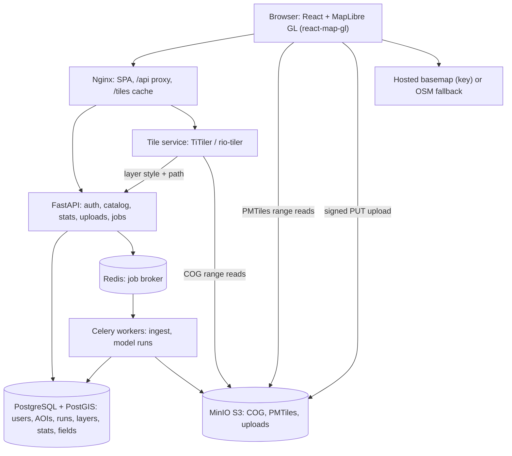
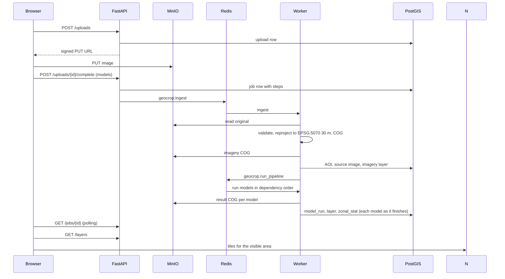

# Architecture

## Principles

1. **Send only what is visible.** The browser asks for tiles of the current view, never whole files.
2. **Raster is the source of truth.** Models write COG files. Polygons are derived and shipped only as vector tiles.
3. **Precompute and cache.** Overviews and statistics are computed once per result. Tile URLs carry a version, so they are cached forever.
4. **Layers are data, not code.** The map and dashboard are built from the catalog the API returns.
5. **Models are plug-ins.** A folder with a manifest and a task. The rest of the system does not change.
6. **Heavy work runs in workers**, never inside a web request.

## Services



| Box | Code | Role |
|---|---|---|
| React app | `web/src/` | Pages, map, layer panel, dashboard, upload, models, status |
| Nginx | `web/nginx.conf` | Serves the app, proxies `/api` and `/tiles`, caches tiles |
| FastAPI | `backend/app/` | REST API v1 (`api/v1/routes.py`), auth, catalog, statistics |
| Tile service | `tiles/main.py` | `/tiles/{layer}/{version}/{z}/{x}/{y}.png`, style from the layer record |
| Workers | `backend/app/workers/` | `geocrop.ingest`, `geocrop.run_pipeline` |
| Model registry | `backend/model_registry/` | Manifests, dependency graph, built-in models |
| Database | `backend/app/db/models.py` | Schema; migrations in `backend/alembic/` |
| Storage | `backend/app/services/storage.py` | S3 or local, one interface |

## Data flow: upload to map



## Database

Tables: `users`, `aoi`, `upload`, `source_image`, `model`, `model_run`, `layer`, `zonal_stat`, `field`, `job`. Geometry is EPSG:4326 with GIST indexes. `layer.kind`, `style`, `legend`, `model.manifest` and `model_run.metrics` are free-form (string / JSONB), so new model outputs need no migration. Rasters are never stored in the database.

## Storage layout (bucket `geocrop`)

```
raw/{upload_id}/original.tif
runs/reference/{kind}-{id}.cog.tif      imagery and reference layers
runs/{run_id}/{kind}-{id}.cog.tif       model outputs
vector/{aoi_id}/{run_id}/{kind}-{id}.pmtiles
```

## Tiles

- Categorical layers: nearest-neighbour resampling, palette from the layer's `style.colormap`.
- Continuous layers: rescale + named colour ramp. Imagery: RGB from bands 3, 2, 1 with a 0 to 2000 stretch.
- Nodata is transparent. Outside the raster the service answers `204`.
- `Cache-Control: public, max-age=31536000, immutable`, plus an nginx `proxy_cache`.
